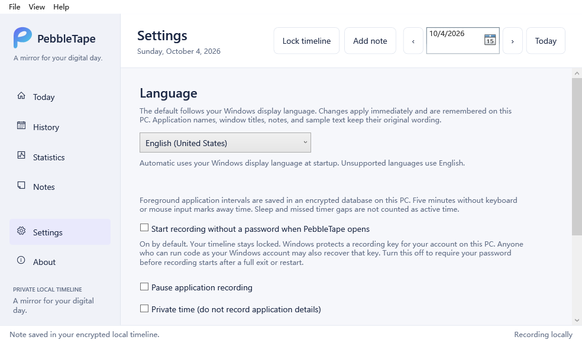

# PebbleTape by HandyPebble

**A mirror for your digital day.**

See where your computer day actually went. PebbleTape records foreground
application time on your Windows PC, keeps an encrypted local history, and lets
you review your day without productivity scores or judgments.

**Everything stays on your PC. No account. No cloud. No tracking server.**

- [Official product page and setup guide](https://handypebble.com/pebbletape/)
- [Download PebbleTape 0.2.0 for Windows x64](https://handypebble.com/pebbletape/downloads/PebbleTape-0.2.0-Setup-x64-win10-compat.exe)
- [Developer's note: memory, awareness, better choices](https://handypebble.com/pebbletape/developer/)
- [HandyPebble](https://handypebble.com/)



## Download the 1.0.3 test build

**Public installer, private application source. No GitHub account needed to download.**

- **[Download PebbleTape 1.0.3 for Windows 10/11 x64](https://github.com/adrovo-max/PebbleTape-showcase/releases/download/v1.0.3/PebbleTape-1.0.3-Setup-x64.exe)**
- [Installation instructions, verification, limitations, and checksum](https://github.com/adrovo-max/PebbleTape-showcase/releases/tag/v1.0.3)

This update keeps the full desktop navigation and calendar/list/editor workspace,
opens in a normal window without automatically maximizing, and applies language
changes without restarting. New setups follow the Windows display language;
you can choose another language or return to Automatic in Settings.

Save your notes and exit Native Preview from its tray menu before installing.
This updates the native 1.0.2 preview while keeping its native data folder. The
older 0.2.0 app remains separate. Keep backups during testing.

This is an **unsigned test build**, not a stable release. Component tests and
repeated application checks passed; physical monitor-DPI transitions, complete
visual acceptance and clean-machine installation remain unverified. Do not
disable Windows security to install it.

Choose the `.exe` under Assets. GitHub's automatic Source code archives contain
this public showcase's documentation, not the proprietary application source.

## Previous 1.0.2 test build

**The program is publicly downloadable. The application source code remains private.**
No GitHub account is needed to download the installer.

- **[Download PebbleTape 1.0.2 for Windows x64](https://github.com/adrovo-max/PebbleTape-showcase/releases/download/v1.0.2/PebbleTape-1.0.2-Setup-x64.exe)**
- [Installation steps, changes, limitations, and SHA-256](https://github.com/adrovo-max/PebbleTape-showcase/releases/tag/v1.0.2)

Version 1.0.2 is an **unsigned prerelease**, not a stable production release.
It adds calendar notes with pictures and refines day/night controls and table repainting.
Exit Native Preview from its tray menu before running the installer. Keep backups
and try nonessential notes first. Do not disable Windows security to install it.

It installs separately as **PebbleTape Native Preview**. Its test data is stored
in `%LOCALAPPDATA%\HandyPebble\PebbleTapeNativePreview\vault`. It does not
migrate or synchronize the old app's data. The installer is approximately 490 KiB;
the older 0.2.0 runtime and installation details below do not describe this build.
Clean-machine installation and extended everyday use still need hands-on testing.

Download the `.exe` under **Assets**, not GitHub's automatic "Source code" archives.
Those archives contain only this public showcase's documentation and images,
not the PebbleTape application source code.

## Version 0.2.0: what you can do

- Record application intervals and review previous days.
- Search and filter entries, see application totals, and save encrypted notes.
- Set a password once. By default, recording starts when you open PebbleTape;
  viewing history still requires your password.
- Require a password before recording starts instead, if you prefer.
- Lock the timeline or hide to the tray while recording continues.
- Pause recording or choose private time without saving application details.
- Follow the Windows display language automatically or choose a language in
  Settings. Navigation supports 12 languages. New recording and security text
  currently supports English and Simplified Chinese, with English fallback for
  other languages.

Window titles are off by default. This version does not capture screenshots,
keystroke contents, or clipboard contents. Recording and history work offline.
Export, automatic history cleanup, and automatic launch at Windows sign-in are
not included yet. Application time describes the foreground window, not effort
or accomplishment.

## Version 0.2.0: install or update

For Windows 10 or Windows 11, x64. The approximately 52 MB installer includes
the runtime and database components; no separate .NET or database-server setup
is needed. Exit PebbleTape from its tray menu before updating. The installer
preserves your local data outside the program folder.

The current compatibility installer has been confirmed to start on a Windows
10 21H2 x64 PC where the original package would not open. It leaves
hardware-enforced stack protection off for the PebbleTape process, without
changing Windows security settings, database encryption, or password protection.
That does not establish compatibility with every Windows installation.

The installer is unsigned. Windows or workplace policy may warn about or block
it. Do not disable Windows security; ask your administrator before installing
on a work or school PC. First setup requires recording consent and a password
of at least 12 characters. There is no password-recovery service.

SHA-256 for `PebbleTape-0.2.0-Setup-x64-win10-compat.exe`:

```text
5F36CA05D0D99B14420BF683DC0ED39650F4A551699E37584C42ADF53E2CEC27
```

## Privacy boundaries

Activity and notes are encrypted locally. Automatic recording additionally
uses a Windows-protected recording key for your Windows account. Software
running as the same Windows user may recover that key. App password protection
is not a defense against malware, administrators, or someone controlling an
unlocked Windows account. Use separate Windows accounts on shared PCs and lock
Windows when stepping away. This is not an independently audited security
product.

## About this repository

This is the official **public product showcase**, not a source-code repository.
It contains only product information, release notes, and a screenshot made with
isolated test data. Native test installers are available in GitHub Releases here. The older 0.2.0 installer remains hosted on HandyPebble.

**Source code is not publicly available. Proprietary software. All rights reserved.**

See [release notes](CHANGELOG.md), [security reporting](SECURITY.md), and the
[rights notice](LICENSE-NOTICE.md).
